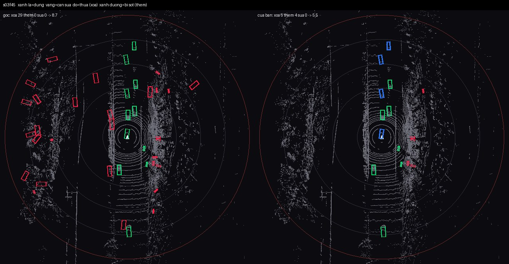

# Báo cáo Day 14 — Bùi Thanh Tân — 2A202603304

- Mã học viên dùng với `--student`: `2A202603304`
- `seed_tag` trong `frames_A.txt`: `82ac3100fd`

## 1. Dự đoán trước sweep (bước 5b)

Ghi **trước** khi chạy `scripts/pp_sweep.py`, rồi commit và push ngay (lịch sử commit là bằng chứng thời điểm viết). Không sửa phần này sau khi có kết quả.

- Tham số tôi nghĩ giảm công sửa nhiều nhất: **`score_thr`** (tăng ngưỡng điểm, khoảng 0.3–0.4). Tham số thứ hai là `min_points` (bỏ box có quá ít điểm LiDAR).
- Vì sao (nhìn ảnh BEV tập A: box thừa nhiều hay box sót nhiều?): **Box thừa nhiều hơn box sót rất nhiều.** Trên ảnh BEV và ảnh camera của cả 3 frame, phần lớn box đỏ (Car) nằm trên hàng rào cây/bụi cỏ ven đường, còn box xanh lá (Cyclist) nằm trên cột đèn, biển báo và lan can. Đo cấu hình gốc so với `ref_A.json`: dự đoán 98 box nhưng GT chỉ có 42; khớp 40, **xóa 58, thêm 2, sửa 3**, chi phí 20.9. Trong đó riêng phần xóa đã chiếm khoảng 58 × 0.3 ≈ 17.4 điểm (≈ 83%). Các box thừa này thường có điểm thấp và ít điểm LiDAR, nên tăng `score_thr` sẽ loại được nhiều box thừa. Box sót chỉ có 2 cái, nên nâng ngưỡng có rủi ro làm sót thêm vài box thật (mỗi box thêm tốn 1 điểm). Vì vậy tôi đoán ngưỡng tối ưu ở mức vừa phải, khoảng 0.3–0.4, chứ không phải mức cao nhất.

## 2. Tập A: sửa tay và tune

| Cấu hình | Xóa | Thêm | Sửa | Chi phí |
|---|---:|---:|---:|---:|
| Gốc | 58 | 2 | 3 | 20.9 |
| `best_config.json` | 16 | 10 | 2 | 15.8 |

- Tham số đã đổi trong `best_config.json`: `score_thr: 0.1 -> 0.5`. Các tham số khác giữ nguyên, kể cả `min_points = 0` và `range_m = 50`. Grid đã quét: `score_thr = 0.1, 0.2, 0.3, 0.4, 0.5` × `min_points = 0, 5, 10` (15 cấu hình × 3 frame).
- Kết quả leave-one-out (dán các dòng `scripts/pp_sweep.py` in ra):

  ```
  Leave-one-out (chọn trên các frame còn lại, chấm trên frame bỏ ra):
    s02f19: cấu hình chọn {'score_thr': '0.5', 'min_points': '0'} → 6.1 (tốt nhất có thể 6.1)
    s03f45: cấu hình chọn {'score_thr': '0.5', 'min_points': '0'} → 5.5 (tốt nhất có thể 5.2)
    s05f04: cấu hình chọn {'score_thr': '0.5', 'min_points': '0'} → 4.2 (tốt nhất có thể 4.2)
  ```

- Cấu hình có ổn định trên từng frame không? Vì sao tôi vẫn chọn (hoặc không chọn) nó: **Khá ổn định.** Bỏ ra frame nào thì 2 frame còn lại vẫn chọn đúng `score_thr = 0.5`. Ở 2/3 frame, cấu hình này đạt đúng mức tốt nhất. Riêng s03f45 chỉ kém mức tốt nhất 0.3 điểm (5.5 so với 5.2, mức 5.2 đạt được ở `score_thr = 0.3`). Cả 3 frame đều giảm chi phí so với gốc (7.1→6.1, 8.7→5.5, 5.1→4.2). `min_points` không ảnh hưởng ở ngưỡng 0.5 (0/5/10 đều cho 15.8) nên tôi giữ 0 cho đơn giản. Tôi vẫn chọn cấu hình này. Tuy vậy, đây là giá trị lớn nhất trong grid, nên ngưỡng tối ưu thật có thể còn cao hơn hoặc nằm giữa 0.3 và 0.5. Ngoài ra, chỉ tune trên 3 frame thì kết quả có rủi ro overfit.

## 3. Trước/sau (bước 8)



- `scripts/pp_compare.py` báo giảm **24%** công sửa trên tập A (tổng chi phí 20.9 → 15.8).
- Dự đoán ở mục 1 đúng hay sai? Giải thích bằng số box xóa/thêm/sửa: **Đúng một nửa.** Đúng ở chỗ `score_thr` là tham số quan trọng nhất. Nâng ngưỡng làm số box phải xóa giảm từ 58 xuống 16 (−42 box, tiết kiệm 42 × 0.3 = 12.6 điểm). Số box sửa cũng giảm từ 3 xuống 2. Còn `min_points`, tham số phụ tôi đoán, gần như không giúp gì: chỉ giảm 0.6 điểm ở ngưỡng thấp và không có tác dụng ở ngưỡng 0.5. Sai ở mức ngưỡng: tôi đoán 0.3–0.4, nhưng tốt nhất lại là 0.5. Cái giá phải trả đúng như tôi lo: số box sót tăng từ 2 lên 10 (+8 × 1 = 8 điểm). Tuy vậy, phần xóa tiết kiệm được nhiều hơn, nên tổng chi phí vẫn giảm 5.1 điểm. Ngưỡng 0.4 (17.5) lại tệ hơn 0.3 (16.8), nghĩa là chi phí không giảm đều theo ngưỡng. Điều này cho thấy với chỉ 3 frame, kết quả khá nhạy với từng box.

## 4. Tập B

Số đo từ `scripts/pp_prelabel.py --frames d14_2A202603304/frames_B.txt --config d14_2A202603304/best_config.json --gt d14_2A202603304/ref_B.json`:

| Xóa | Thêm | Sửa | Chi phí |
|---:|---:|---:|---:|
| 37 | 23 | 7 | 37.6 |

(12 frame, GT 146 box, dự đoán 160 box, khớp 123. Frame tốn nhất là s04f01 với chi phí 7.0: xóa 5, thêm 5, sửa 1.)

- Loại box tốn công sửa nhất ở tập B: **box bị sót phải thêm tay**, chủ yếu là **Truck/Bus và Pedestrian**. 23 box phải thêm (1 điểm mỗi box) chiếm 23/37.6 ≈ 61% chi phí. `ref_B.json` có 7 Truck và 3 Bus, nhưng model không dự đoán ra box Truck/Bus nào. Pedestrian trong GT có 10 nhưng model chỉ ra 4. Ngược lại, model dự đoán 132 Car so với 107 Car trong GT, nên phần lớn 37 box phải xóa (11.1 điểm) là Car thừa. Ngưỡng 0.5 đã cắt bớt nhưng chưa hết.

## 5. Giới hạn

- **Chỉ tune trên 3 frame.** Mỗi box lệch cũng làm chi phí thay đổi rõ, ví dụ ngưỡng 0.4 lại tệ hơn 0.3. Leave-one-out mới chỉ có 3 lần thử, nên chưa đủ để khẳng định `score_thr = 0.5` là tốt nhất cho cả bộ dữ liệu VF.
- **Model huấn luyện trên KITTI** nên chỉ có 3 lớp Car/Cyclist/Pedestrian, không có Truck/Bus. Tất cả Truck/Bus ở tập B đều phải thêm tay hoặc sửa lớp, và không tham số ngưỡng nào khắc phục được điều này. Ngoài ra, cảm biến và cách lắp LiDAR của VF khác KITTI (mật độ điểm, độ cao, cường độ), nên model nhận nhầm hàng rào cây và cột đèn thành Car/Cyclist.
- **Grid còn hẹp:** `score_thr` chỉ quét tới 0.5, đúng bằng giá trị tốt nhất (nằm ở biên). Tôi chưa thử ngưỡng riêng cho từng lớp (`thr_car`, `thr_cyc`, `thr_ped`) hay `nms_thr`. Ngưỡng riêng có thể giữ lại Pedestrian mà vẫn lọc bớt Car thừa.
- **Chi phí chỉ là công thức** (`0.3 × xóa + 1 × thêm + 0.5 × sửa`), chưa phải thời gian sửa thật trên CVAT. Box làm "đáp án" (`ref_A/ref_B`) cũng do chính tôi sửa tay, nên có thể còn sót hoặc lệch.
